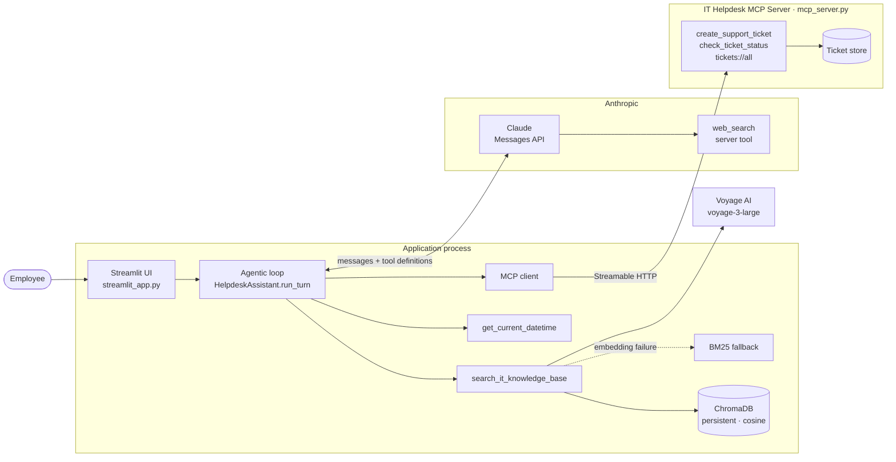
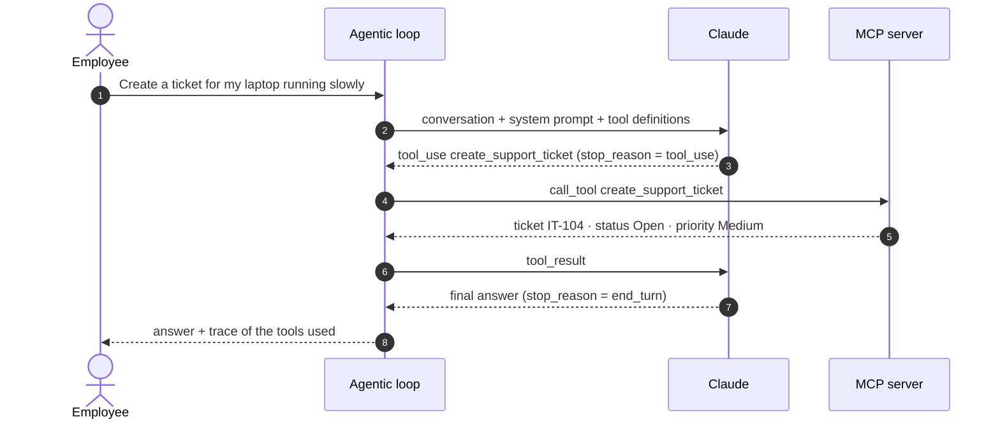

# IT Helpdesk Assistant

**An agentic LLM system for IT support that combines retrieval-augmented generation,
client- and server-side tool use, and the Model Context Protocol.**


## Abstract

Most IT support traffic falls into three kinds of request: troubleshooting questions with
known answers, questions that need current information, and actions in a ticketing system.
This project implements a single conversational agent that handles all three. Built on
Claude, the assistant treats every capability as a tool: semantic search over an internal
knowledge base, live web search, and ticket operations served by a standalone MCP server.
On each turn the model decides which tools, if any, to call. The system keeps working when
a dependency fails. If the embedding provider is rate-limited, retrieval falls back to a
BM25 ranker written from scratch. If the ticketing service is unreachable, the agent keeps
answering and tells the user what it cannot do. Every answer comes with a trace of the
tools that produced it, which the user can inspect.

## Highlights

- **Model-driven orchestration.** A hand-written agentic loop over the Claude Messages API.
  The loop is driven by `stop_reason` (`tool_use`, `pause_turn`, `end_turn`) and never by
  parsing model output.
- **Retrieval as a tool, not a pipeline stage.** The model calls `search_it_knowledge_base`
  only when a question needs it, so greetings and ticket operations never trigger an
  embedding call.
- **Fault-tolerant retrieval.** Dense retrieval uses Voyage AI `voyage-3-large` with ChromaDB
  (cosine similarity). If it fails, an Okapi BM25 ranker searches the same chunks instead.
- **Protocol-level integration.** Ticket operations run on an MCP server over Streamable
  HTTP. The client discovers tools at runtime and converts their schemas into Claude tool
  definitions, so adding a tool to the server needs no client changes.
- **Machine-actionable errors.** Tools return structured errors (`category`, `retryable`,
  `message`), so the model can tell invalid input apart from a missing record.
- **Transparency by default.** Every response shows the tools that were called, their
  inputs and outputs, and any web sources cited.

## Architecture



The system runs in three places. **Client tools** run in the application process. The
**server tool** (`web_search`) runs on Anthropic's infrastructure inside the model call.
**Ticket operations** live in a separate MCP server process that owns its data and checks
every input itself.

## Anatomy of a turn



`HelpdeskAssistant.run_turn` works as follows:

1. Send the conversation, the system prompt and the current tool set to Claude.
2. If `stop_reason == "tool_use"`, run every `tool_use` block in the response (one response
   can request several). Append the results as `tool_result` blocks, marking failures with
   `is_error: true`, then call Claude again.
3. If `stop_reason == "pause_turn"`, a long server-side web search was paused. Send the
   partial turn back so Claude can resume it.
4. Otherwise, the answer is the text Claude wrote after its last tool activity.

A hard limit of 10 model calls per turn is there only to stop runaway loops. The loop
normally ends on `stop_reason`.

## Components

### Retrieval-augmented generation

| Stage | Design choice | Rationale |
| --- | --- | --- |
| Chunking | One chunk per `##` section of the FAQ | Each section is a self-contained Q&A pair; splitting it would separate the question from its answer |
| Embedding | `voyage-3-large`, with `input_type="document"` for chunks and `"query"` for questions | The model encodes queries and passages differently to improve retrieval |
| Index | ChromaDB `PersistentClient`, HNSW with cosine distance | Vectors persist across restarts; cosine distance ignores vector length and compares direction only |
| Indexing policy | Re-embed only when the stored chunks differ from the source file, in a single batched call | Restarts make no embedding calls, and edits to the FAQ are picked up automatically |
| Namespacing | Collection name derived from the embedding model | Switching models never mixes vectors from different models |
| Query cache | In-process cache of query embeddings | Repeated questions skip the embedding call |
| Fallback | Okapi BM25 (`k1 = 1.5`, `b = 0.75`) over the same chunks | Retrieval keeps working during provider outages and free-tier rate limits; results are labelled `keyword_fallback` |

### Tools

| Tool | Kind | Executed by | Purpose |
| --- | --- | --- | --- |
| `search_it_knowledge_base` | Client tool (RAG) | Application | Semantic search over the internal IT FAQ |
| `get_current_datetime` | Client tool | Application | Answers date and time questions from the system clock so the model does not guess |
| `web_search` | Server tool (`web_search_20250305`, at most 3 searches per request) | Anthropic | Current information beyond the knowledge base, with citations |
| `create_support_ticket` | MCP tool | MCP server | Opens a ticket after validating the employee, issue and priority |
| `check_ticket_status` | MCP tool | MCP server | Looks up an existing ticket by ID |
| `tickets://all` | MCP resource | MCP server | Read-only ticket list shown in the UI sidebar |

The system prompt sets out which tool to use when:

- the knowledge base first;
- web search when the knowledge base has no answer or the user asks for recent information;
- the ticket tools only when the user explicitly asks for them.

Each tool description repeats these rules, stating both when to use the tool and when not to.

### MCP server

`mcp_server.py` is a separate process that serves the ticketing system over the Model
Context Protocol. It uses the Streamable HTTP transport and listens on
`http://127.0.0.1:3000/mcp`.

- The server validates every input itself instead of trusting the model to send well-formed
  data.
- Errors are structured so the model can recover in one step:

  ```json
  {"error": {"category": "not_found", "retryable": false,
             "message": "No ticket with id 'IT-999'. Existing ids: IT-101, IT-102, IT-103."}}
  ```

  `retryable: false` tells the model that repeating the same call will not help, and the
  message lists the valid IDs. A missing ticket is treated as a valid answer, not as a
  system failure.
- The client opens a short-lived session for each call and discovers tools with
  `list_tools()`. It runs only the tools the server has advertised.

## Reliability

| Failure mode | System behaviour |
| --- | --- |
| Embedding provider rate-limited or unavailable | Search falls back to BM25. Indexing retries up to 3 times, waiting out the rate-limit window between attempts |
| MCP server not running | The agent keeps answering with RAG and web search, and is told the ticket system is unavailable. It looks for the tools again on every turn, and the UI has a reconnect button |
| Tool raises an exception | The error goes back to the model as a `tool_result` with `is_error: true`, so the turn does not crash |
| Long-running server tool | The loop resumes `pause_turn` responses automatically |
| Runaway tool loop | Hard limit of 10 model calls per turn |
| Failure mid-turn in the UI | The conversation history is rolled back so the next request is still valid |
| Missing API key | A configuration error explains how to fix it |

## Security considerations

- **Secrets** come only from the environment (`.env`, which git ignores). `.env.example`
  lists the required variables.
- **The MCP server listens only on localhost by default**, as the MCP specification
  recommends for local servers.
- **Allow-list dispatch.** Only tools defined by the application or advertised by the MCP
  server can run.
- **Grounding rules.** The system prompt forbids inventing ticket IDs, statuses or
  troubleshooting steps, and requires every answer to say where its information came from.

## Getting started

**Prerequisites:** Python 3.10+, an [Anthropic API key](https://console.anthropic.com/) and a
[Voyage AI API key](https://dash.voyageai.com/).

```bash
git clone https://github.com/marlontecotl/it-helpdesk-assistant.git
cd it-helpdesk-assistant
python3 -m venv .venv && source .venv/bin/activate   # Windows: .venv\Scripts\activate
pip install -r requirements.txt
cp .env.example .env                                  # add ANTHROPIC_API_KEY and VOYAGE_API_KEY
```

Start the two processes in separate terminals:

```bash
python mcp_server.py              # MCP server  ->  http://127.0.0.1:3000/mcp
streamlit run streamlit_app.py    # Chat UI     ->  http://localhost:8501
```

The first launch embeds the knowledge base in a single API call. Later launches reuse the
vectors stored in `.chroma/`.

## Configuration

| Variable | Default | Description |
| --- | --- | --- |
| `ANTHROPIC_API_KEY` | (required) | Claude API key |
| `VOYAGE_API_KEY` | (required) | Voyage AI API key |
| `CLAUDE_MODEL` | `claude-haiku-5-5` | Model used by the agent |
| `VOYAGE_MODEL` | `voyage-3-large` | Embedding model |
| `MCP_SERVER_URL` | `http://127.0.0.1:3000/mcp` | Address the application connects to |
| `MCP_HOST` / `MCP_PORT` | `127.0.0.1` / `3000` | Address the MCP server listens on |
| `CHROMA_DIR` | `.chroma/` | Location of the vector store |

## Example queries

| Prompt | Expected route |
| --- | --- |
| How do I fix network connectivity issues? | `search_it_knowledge_base` |
| My computer is running slow. What should I do? | `search_it_knowledge_base` |
| How can I protect my laptop from malware? | `search_it_knowledge_base` |
| Search for the latest Windows 11 Wi-Fi troubleshooting steps. | `web_search` |
| Find solutions for Outlook not syncing emails. | `web_search` |
| Create a ticket for my laptop running slowly. | `create_support_ticket` |
| Check the status of ticket IT-101. | `check_ticket_status` |
| What is the current date and time? | `get_current_datetime` |
| Hi, who are you? | No tool; answered directly |

All of them except the last are one click away in the sidebar. Expand **How this was
answered** under any reply to see each tool call with its input and output.

## Repository structure

```
.
├── app_implementation.py    Agentic loop, RAG pipeline, client tools and MCP client
├── mcp_server.py            IT Helpdesk MCP Server (tools, resource, validation)
├── streamlit_app.py         Chat interface and tool-call trace
├── data/
│   ├── it_sector.txt        IT support knowledge base (FAQ)
│   └── mcp_tool_data.json   Sample tickets loaded when the server starts
├── requirements.txt
└── .env.example             Environment variables
```

## Design trade-offs

- **Stateless MCP client.** A new session per call keeps the client simple and unaffected
  by server restarts, but every call pays for a handshake. Under real load, the next step
  would be one long-lived session that the calls share.
- **In-memory ticket store.** Keeps the server free of dependencies; tickets reset when it
  restarts.
- **Section-level chunking.** Works best for a small, well-structured FAQ. A larger mixed
  corpus would need chunks with a token limit and some overlap.
- **Default model.** `claude-haiku-5-5` keeps latency and cost low, which suits
  high-volume support traffic. Any Claude model can be used through `CLAUDE_MODEL`.

## Limitations and future work

- **Evaluation.** Build an offline evaluation suite on a labelled query set: retrieval
  recall@k and MRR, accuracy of tool selection, and answer faithfulness scored by an LLM judge.
- **Retrieval quality.** Combine the dense and BM25 rankings with reciprocal rank fusion
  instead of using BM25 only as a fallback, and add a reranker.
- **Production hardening.** Persistent ticket storage, authentication on the MCP server
  (OAuth 2.1, following the MCP authorization specification), and structured tracing with
  OpenTelemetry.
- **Efficiency.** Prompt caching for the system prompt and tool definitions, and streaming
  responses to the UI.

## Author

**Marlon Tecotl** · [github.com/marlontecotl](https://github.com/marlontecotl)
